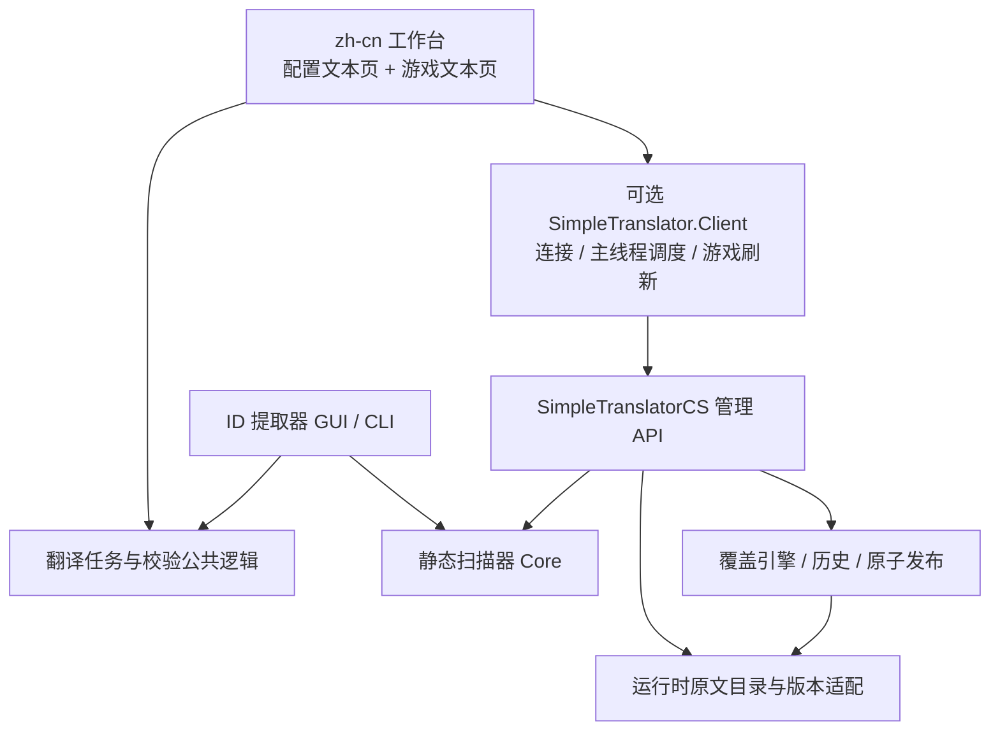

# 汉化工作台、提取器与 SimpleTranslatorCS 集成设计

版本：设计草案 0.1，2026-09-19。本文中的接口、配置和目录为待实现建议，不是现有 API。事实依据见 [现状检查](PROJECT_INVENTORY.zh-CN.md)，实施顺序见 [路线与接手](IMPLEMENTATION_HANDOFF.zh-CN.md)。

## 1. 产品边界与推荐选择

目标工作流：用户选择模组和范围，配置自己的翻译接口，自动获得初译；可校对、查看冲突、保存、回滚，并在支持的场景刷新游戏显示。

### 功能放在哪里

| 方案 | 优点 | 核心问题 | 建议 |
| --- | --- | --- | --- |
| 全部并入 SimpleTranslatorCS | 无客户端也能处理数据 | 服务器不提供 Unity UI；网络翻译不应阻塞启动/游戏请求；普通玩家无法自行刷新已缓存 UI | 仅放服务端职责 |
| 全部并入 zh-cn | 用户入口统一、可复用现有 UI | 原插件将强绑定 EFT 内部 API 和服务端；net471 不能直接加载 net8 Core；配置汉化用户被迫安装额外依赖 | 避免整体混入 |
| 新建完整客户端汉化工具 | 独立产品定位 | 重做 UI、密钥设置、批量任务、历史管理，维护两套工作台 | 现阶段不推荐 |
| **工作台统一入口 + 可选轻量客户端桥接 + 服务端 API** | 复用工作台、保持各自独立、版本差异集中 | 需要定义清楚模块接口与刷新能力探测 | **推荐** |
| 独立桌面/CLI 或以后加 Web 编辑器 | 不开游戏也能批量制作汉化；适合维护者 | 看不到游戏实时 UI；新增 Web 前端有额外成本 | 保留现有桌面/CLI；Web 后置 |

“独立客户端模块”与“共用工作台”可以同时成立。建议一个可选 `SimpleTranslator.Client` 插件提供连接与刷新，并通过工作台模块 API 注册“服务端游戏文本”页。没装 zh-cn 时仍能以简单快捷键/配置项刷新；没装 Client 时 SimpleTranslatorCS 仍能正常启动并应用既有翻译。

桥接业务不依赖工作台内部静态类。可在同一个发行包附带两 DLL，物理发布方式可以以后决定；职责和版本边界先保持独立。

## 2. 职责与依赖方向



图中的公共逻辑是未来可分别编译的纯逻辑边界，不代表所有进程立即引用同一个 DLL。客户端与服务器通过版本化 DTO 通信，不传 CLR 类型或程序集对象。

### 服务端

管理已加载模组与文本清单、原文和生效值、翻译包层级、条目验证、保存、历史、重载和修订号。数据库访问通过 4.0 / 4.1 适配器。提取/编辑可以关闭，普通翻译覆盖继续可用。

### 提取器

保留独立 GUI/CLI。把 Core 扫描能力以版本化库或受控源码共享方式接入服务端；不要依赖开发者机器上的绝对 ProjectReference 路径。未来连接服务端时复用同一目录和提交协议。离线目录扫描和在线运行时目录都是有效入口。

### 工作台

成为可扩展的工作界面：数据源获取条目、翻译任务产生候选译文、编辑器比较修改、存储适配器提交、刷新适配器请求应用。原有配置汉化路径保留，新的游戏文本路径独立。

### 客户端桥接

发现实际服务器地址、握手、维护连接状态与修订号；获取新的 locale；在 Unity 主线程应用；按已验证范围触发 UI 更新。保存服务端文件、运行扫描器及调用大量数据库操作不放在 Unity 主线程。

## 3. 核心数据模型：身份、来源、应用位置分开

建议至少定义以下概念：

| 概念 | 必需内容 |
| --- | --- |
| TextTarget | domain、targetLocale、原始 key、Dialogue/配置项等必要 scope |
| SourceCandidate | recordId、TextTarget、sourceText、sourceLanguage、mod 身份候选、类别、来源类型、文件/JSON 路径、识别规则、置信度、备选值 |
| TranslationEntry | recordId、TextTarget、sourceHash、contextHash、译文、人工/AI/机翻来源、状态、包 ID、提供商配置指纹 |
| TranslationSnapshot | schemaVersion、修订号、源目录指纹、启用包及顺序、不可变合并结果、来源链、诊断 |
| TranslationJob | jobId、固定条目清单、源快照版本、配置指纹、进度、取消状态、通过校验的草稿 |
| ApplyResult | 持久化版本、服务端已应用版本、是否待刷新客户端、各域失败/延迟原因 |

domain 至少分为 `client.config`、`server.global`、`server.menu`、`server.dialogue`。MVP 先实现 server.global，其他域用能力标记说明尚未支持。

关键规则：

- 工作记录可以按模组分组，但 Global 的实际应用位置仍是“语言 + 原始 key”。两个 mod 写同一个 Global key 必须显示冲突，不能因为记录 ID 不同而隐藏冲突。
- Dialogue 同名 key 可能位于多个 element；新格式应支持明确位置。具体稳定 element 标识尚待检查，没有可靠 ID 时使用受原文快照校验的路径，不能凭空规定每个 element 必有 ID。
- 旧版 dialogue 扁平文件继续按原有“匹配所有包含此 key 的 element”规则解释，并标注其作用范围。
- recordId 应来自版本化的结构化身份编码/哈希，避免简单 `a|b|c` 拼接产生分隔符碰撞。编辑请求使用 recordId，服务端重新解析到允许的目标。
- 原始 key 和大小写保留。冲突比较遵从目标容器：当前 4.1 Global 大小写不敏感；不要对所有域强制小写。
- 不混用 UI 语言名称和游戏语言 key：界面可称“简体中文”，当前 SimpleTranslatorCS 目标是 `ch`；提取器输出文件名 `zh-cn.jsonc` 不表示 SPT 字典一定叫 `zh-cn`。

## 4. 原文从哪里来

### A. 静态扫描

复用 LocaleScanner。用户选择一个服务端已知 mod，服务器把 modId 映射到允许的目录；桌面离线模式可以保留原有文件选择器。补齐 scope、来源归属和候选记录，不用扫描器当前全局裸 key 合并的结果作为最终目录。

优点是来源明确、游戏未启动也能工作；缺点是遗漏 DLL 运行时生成内容，且文件内容不一定是最终运行值。

### B. 运行时文本目录

在服务端数据和目标 mods 加载后获取英文 locale、当前中文、相关模板引用、Dialogue 英文槽位，补全动态词条。记录采集时点与快照版本；不要在每次查询都重扫所有文件或重建全库。

必须区分：原文、其他 mod 已改写后的基底、我们的覆盖结果。不要把当前中文最终输出当成下一轮英文原文，也不要因热加载反复提取自己的生成文件。

运行时最终键集不携带可靠“最后由哪个 mod 写入”的完整历史。MVP 用静态来源 + 模板引用 + 运行时存在性匹配，无法归属的条目标记 `unknown` 或 `multiple`。不能仅凭加载顺序或一个 MongoId 自动归属到 mod。逐 mod 插桩捕获变更属于后续高成本研究项，不是 MVP 承诺。

### C. 组合策略

以静态候选提供出处，以运行时结果判断当前可见值和引用。两者不同保留双方，不静默丢弃；原版键、mod 新增键、mod 改写原版键分开展示。默认只处理选中 mod 的候选，不把完整游戏英文词库自动送去翻译。

“缺少有效中文”由分层记录、原文基准与用户策略决定；仅用“含不含中文”或“中文等于英文”不足以判断专有名词是否需要翻译。

## 5. 自动初译与用户设置

### 默认执行位置

工作台/桌面端调用用户选择的 API，密钥留在发起端内存；服务端不需要获得玩家的个人 API key，只接收候选译文并执行独立校验。这样普通远程玩家不会把密钥交给共享服务器。

无工作台用户可继续用 CLI 翻译并导入。可选的“服务器管理员自动翻译任务”以后独立实现，由管理员明确配置执行节点、密钥和范围；不可让任意客户端触发管理员额度消费。两种模式使用相同任务和验证语义，不应维护两套不一致规则。

### 推荐设置

| 设置 | 建议默认 | 说明 |
| --- | --- | --- |
| provider / protocol / endpoint / model | 用户选择 | 协议与服务商名称分离，不把所有提供商当作 Chat Completions |
| targetLanguage / gameLocaleKey | 简体中文 / ch | 保留明确映射 |
| scope | 选中 mod、Global | 不默认全库 |
| onlyMissingValidTranslation | true | 跳过有效人工和已有初译；过期按策略重译 |
| autoTranslateNewEntries | false | 可选在已授权范围发现新条目后初译；配置缺失时等待，不反复失败重试 |
| autoApplyValidatedDrafts | false | 可选自动应用到 AI 层，仍不能覆盖人工层；无需每批再弹确认 |
| maxEntries / maxCharactersPerRun | 有界 | 限制自动任务规模；字符估算不等于精确 token 或费用 |
| batchSize / timeout / maxRetries | 有界 | 按条数及长度分批，取消、429/5xx 退避和重试上限 |
| glossary / promptProfile | EFT 游戏文本 | 配置标签、物品短名、任务叙事分别选上下文 |

“启用 AI 译文显示”“启动自动翻译”“把草稿应用到游戏”是三个不同动作。开启显示层不应自动产生付费请求。用户明确启用自动处理后，在设定范围和上限内自动执行，不反复要求同一授权。

### 执行链

1. 生成候选清单，排除来源不明且需复核、未解决冲突、空源文和范围外内容。
2. 固定 recordId、源哈希、上下文、目录版本、模型/协议/端点/术语表/提示词/校验器版本。
3. 复用同配置及同语境的有效结果；进行有界分批和去重。相同英文但不同上下文不盲目复用。
4. 异步调用；原文是数据，不执行其中的指令。不上传整个 mod 文件、玩家存档或配置当前值。
5. 检查返回 ID 集合、重复键、字符串类型和必要的保护标记；服务器提交时再检查一次。
6. 将结果保存到草稿区；失败批次不发布。已验证批次可作重试缓存，不能伪装成完整活动语言包。
7. 人工比较后应用，或按已启用的自动应用策略提交 AI 层；提交前重新核对源哈希和修订号。
8. 服务端应用成功后通知客户端有新版本；客户端刷新成功再报告“游戏已刷新”。

保护规则必须覆盖 `${mongoId}`、`${mongoId|short}`、花括号/printf 占位符、标签及嵌套顺序、必要数字、URL/路径、换行。保留结构不等于语义正确；语义复核状态独立保存。

复用路线：提取器的三协议适配作为现代端起点，工作台的指纹、分层追踪、任务完整性与严格验证作为公共逻辑参考。先抽小型可移植实现并做 Mono 冒烟测试，再决定共享 DLL/多目标编译。移植完成前不要宣传两个前端已具备完全相同提供商能力。

## 6. 存储、优先级与发布

推荐内部保存丰富元数据，导出仍生成旧式扁平 JSONC。不要要求用户把原有语言包全部迁移。

建议目录布局：

```text
SimpleTranslatorCS 模组目录/
  db/locales/ch/                 兼容现有普通译文
    dialogue/                    兼容现有 dialogue 译文
  workbench/
    manifests/                   可选包元数据
    sources/                     原文快照及来源
    drafts/                      AI/人工待提交草稿
    history/                     历史与回滚数据
    generations/                 已验证、不可变的发布版本
    active.json                  当前活动版本引用
  config.jsonc
```

新存储需由新引擎明确加载；旧扫描器仍只处理 db/locales。历史、报告和草稿放在扫描目录外，避免被当作翻译覆盖。保留用户旧文件与注释，不批量重写；新格式支持 schemaVersion 和向后迁移。

默认优先关系建议为：**用户明确人工覆盖 > 有效人工语言包/旧版文件 > AI 初译 > 临时机翻 > 游戏基底**；同层再比较包 priority、依赖顺序和稳定 ID。显式“强制覆盖人工”不能隐含在提高 AI 包优先级中。旧版文件视作人工来源，但没有历史原文时标记“基准未知”，不能声称已通过过期校验。

运行时覆盖条件（replace / onlyMissing / originalMatches）与翻译来源层级独立。删除某条覆盖是恢复下层，不是向游戏写入空字符串；需要区分 removeOverride 与 setValue。

发布应准备完整 generation，写入及校验所有文件后原子切换活动引用；读者不枚举尚未完成的目录。磁盘活动版本与内存快照切换之间可能失败，必须记录 persistedRevision / appliedRevision，启动时可恢复，不能把 File.Replace 当成跨进程事务。API 保存与 watcher 都走同一串行发布入口，生成文件事件要去重，避免循环重载。

优先使用单个统一快照、全包合并后解析占位符。无缓存版本下一次读取执行新快照；4.1.3 清目标语言缓存。不能每次追加 transformer；不能通过直接重启服务器完成所谓热加载。

4.1.3 Clear 可能丢失别的 mod 对缓存字典的直接修改；先验证兼容性，再启用该模式。来源不明的后续改写不能靠旧备份盲目覆盖。更多边界见 [原评估](ARCHITECTURE_REVIEW.zh-CN.md)。

## 7. 服务端接口草案

建议逻辑命名空间 `/simpletranslator/v1`。下表是能力契约，不规定已存在的 HTTP verb 或 SPT route 注册方式；实施时分别对接两版实际路由/序列化接口，避免占用已有 `/client/locale/` 路由。

| 操作 | 请求内容 | 结果与要求 |
| --- | --- | --- |
| capabilities | 协议版本、客户端能力 | 服务端/引擎版本、实例 ID、已授权权限、支持域、缓存策略、修订号 |
| mods | 分页/过滤 | 已加载 mod 身份、版本及扫描能力；不回传任意系统路径 |
| inventory/query | snapshotId、modId、domain、类别、状态、游标 | 有界分页的条目、源哈希、有效译文、归属置信度 |
| inventory/scan | 已知 modId 列表 | 后台 jobId；不接受任意磁盘路径 |
| jobs/status / jobs/cancel | jobId | 扫描/导入任务进度与取消；执行端的翻译任务使用同样状态模型 |
| drafts/validate | 候选译文、源哈希、baseRevision | 格式、范围、冲突、过期校验；不修改活动版本 |
| drafts/commit | draftId、baseRevision、idempotencyKey | 事务性创建新版本；源变化/版本冲突返回 conflict，不默默覆盖 |
| overrides/remove | 已授权条目/层、baseRevision | 删除自有覆盖、回退下层，不删除其他作者文件 |
| reload | 预期已保存版本 | 串行加载并返回 appliedRevision，不重复注册 transformer |
| history / rollback | 范围、版本 | 查看允许的历史；回滚也经过校验并生成新修订 |
| changes | 服务器实例 ID、afterRevision | 变更摘要；断档或重启要求完整同步 |

接口版本与 mod 版本分开。握手缺少关键能力时降级为只读、导出，或提示需更新；不能盲目调用不存在的刷新 API。分页绑定固定 snapshotId，避免翻页期间混用多个原文版本。

提交是 compare-and-swap：后台翻译期间用户改了原文、包顺序、人工译文或服务器重启，旧任务必须重新校验。持久化来源和生效来源分别记录；失败响应要区分“未保存”“已保存但未应用”“已应用但客户端未刷新”。超时后使用同一个幂等键查询/重试，避免重复发布。

### 权限与联机边界

“在线编辑”默认指当前游戏会话里的服务端连接，不自动意味着对公网开放编辑器。单机管理权限和 Fika/远程普通玩家权限不同。

- 服务端修改属于共享状态，只有本机管理员或明确授权编辑者可提交/重载/回滚；持有普通游戏 session 不等于有编辑权限。
- 客户端本地临时预览与服务端共享翻译必须明显分开。MVP 不实现多人实时协同编辑，采用修订冲突检查。
- 扫描和保存使用服务端已知 modId、包 ID；规范化并约束所有最终文件路径，不能暴露通用读写路径接口。
- 请求分页、字数、体积、任务并发有上限；只返回可翻译数据。密钥和提供商响应脱敏，不记录 Authorization。
- 使用现有经过验证的连接机制，并明确管理认证。不能假设 loopback、CORS 或登录会话本身就是管理授权；远程启用需明确配置。不要为方便连接全局关闭证书校验。
- 未来 Web UI 再加入浏览器来源/CSRF 防护；目前不额外部署 Web 服务。

## 8. 工作台扩展与游戏内刷新

### 工作台模块

先定义最小注册面：moduleId、显示名、能力、条目查询、任务入口、保存结果、刷新状态。现有配置文本通过 ConfigTextProvider 接入；新游戏文本通过 ServerTextProvider 接入。模块接口只传纯 DTO/回调，不传 SPT 类型。

保留一个工作台入口，通过“客户端配置 / 服务端游戏文本”切换。游戏文本页支持 mod、类别、语言、人工/AI 层、冲突、过期、来源不明筛选；列表分页或虚拟化，避免 IMGUI 每帧处理全量词库。API 密钥设置和术语表可复用，但两个域的提示词、存储和应用状态独立。

编辑器显示原文、当前生效值、候选译文、覆盖来源、待核对原因。名称相同不代表身份相同，选择必须绑定 recordId。人工保存、AI 初译和清除覆盖都生成明确变更，不直接操作服务端路径。

### 刷新分级

| 级别 | 能力 | 验收要求 |
| --- | --- | --- |
| L0 | 服务端新版本已应用 | 下一次相关服务端读取返回新值 |
| L1 | 客户端 locale 缓存已更新 | 后续查询读到新值；不等于当前画面全量更新 |
| L2 | 指定界面已刷新 | 已打开物品详情、任务页等分别验证刷新入口 |
| L3 | 所有相关界面与 Dialogue 即时更新 | 高成本后续目标，不能由 L1/L2 推断 |

当前 zh-cn 的 BuildSettingList 属于配置界面刷新，不覆盖表中 EFT 的 L1/L2。客户端桥接的首项研究任务是找出并验证两套游戏客户端的语言获取、缓存、变更通知和 UI 重绑定入口；本轮没有验证具体方法名。

推荐状态机：检测新修订 → 合并重复刷新请求 → 异步拉取数据 → 验证对应实例/语言/修订 → 主线程应用 → 触发已支持 UI 更新 → 记录 clientAppliedRevision。快速连续变更只应用最新有效版，断连保持当前有效文本；服务器重启后不能仅比较一个递增整数。

首次版本只支持主菜单/非战局主动刷新。战局中检测到变更先显示待刷新，待验证后再逐步开放即时应用。某个 UI 已把文本拷入自己的字段时，改 locale 字典不会自动改变它；应返回“重新打开该界面/重进客户端”等真实降级结果，不强制卸载场景或重建玩家对象。

Dialogue 与旧邮件、存档里的已生成文本分开处理；刷新模板不承诺回写既有邮件/任务存档。客户端刷新失败不应把正常服务端译文回滚，二者状态分开。

## 9. 可选后续方向

- 管理员无客户端自动扫描/初译服务，重用任务引擎，限范围且可取消。
- 桌面提取器连接运行中服务器，查看动态文本、提交草稿、请求重载。
- 更完整 Menu / Dialogue 编辑与游戏内刷新。
- 以 locale key 为基础的文本定位，先从条目搜索/复制 ID 开始；任意屏幕抓词不是现有配置控件抓取的自然扩展。
- 翻译记忆、共享术语库、导入第三方语言包、源版本升级差异报告。
- 按明确协议提供给其他 mod 的运行时文本登记 API，改善源归属。
- Web 编辑器、多用户协作、版本同步属于后续产品，先不与 MVP 绑定。

不纳入首版：运行时替换 mod DLL、任意脚本执行、修改原版数据库文件、自动反编译并运行不可信 mod、战局中强制全量 UI 重建、每次启动自动翻译整个游戏。
