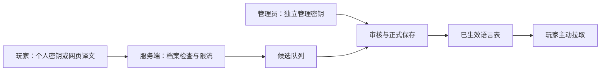

# 1.12.0 / 2.12.0 翻译优化与维护说明

本次实现覆盖 SimpleTranslatorCS 服务端与 ConfigurationManager.zh-cn 客户端。沿用协议 2，通过 capabilities 中的功能标记协商新增能力；旧客户端仍可使用原接口，新客户端遇到旧服务端会隐藏新增选项。

## 工作与权限如何分配

游戏文本的词条目录、原文基准、资格判断、API 请求、分批执行、校验、存储和管理员审核均在 SimpleTranslatorCS。客户端提供本次任务的个人密钥和选项，选择管理员预先配置的供应商接口。客户端自己的 F12 插件设置翻译仍在本机执行，无需安装服务端组件。

管理员在 `translation-providers.jsonc` 配置自己的 API 链接。玩家可选择预设并使用自己的密钥；玩家请求不能覆盖接口地址、参数适配器或目标语言。这样不会把客户端提交的任意 URL 当作服务器网络访问入口。与网页手动回填相比，服务端 API 模式会把个人密钥交给服务器运营者，应选择可信服务器。



Fika 战局房主、Headless、客户端自报用户名或 profile/session ID 都不会自动获得汉化写权限。修改正式文本、文件开关、重载、基准和审核仍要求独立管理员密钥。普通玩家只能拉取或提交候选，每次最多 30 条；候选未经审核不应用。

路由增加已有档案检查、每身份每分钟 120 次与全局每分钟 600 次上限；人工贡献间隔 60 秒，原有 API 贡献冷却保留。原文变化或已经不再缺失的旧候选不会占用新任务额度；后续提交时清理无效候选。任务状态与取消请求绑定任务 ID，阻止旧界面取消后来启动的任务。审计日志对会话 ID 使用摘要，并且异常响应不回传服务器路径或原始异常正文。

客户端管理员密钥改为仅在本次会话保留，旧 BepInEx 明文设置加载后清空。服务器或玩家会话切换时清空服务端相关凭据并重新探测；新服务端模式下，不能识别连接身份的未来请求通道会阻止凭据发送，保留网页贡献路径。供应商配置校验返回指纹，配置变化后服务端拒绝使用旧快照发送密钥。

这些措施不替代 SPT/Fika 自身的登录认证。已有档案 ID 仅是身份线索，不能证明持有人身份，因此绝不依靠它授予管理员权限。公开联网时仍需要由部署层保护 SPT/Fika HTTP 服务及访问范围；本 mod 不能在 SPT 已反序列化请求之前限制整个 HTTP 请求体。可在代理层设置请求体上限（本工作台批量回填内容上限 500000 字符）。本次没有进行真实公网攻击测试或多人战局验证。

Fika 依据：[官方组织](https://github.com/project-fika)、[Fika API 文档](https://wiki.project-fika.com/advanced-features/fika-api)。Fika API 自有 bearer 密钥与汉化管理员密钥各自独立。

## token 与高级选项

- 待审核的相同 ID 与相同原文不再重复付费；管理员任务也会跳过。原文变化后允许重新提交。
- 服务端同一任务按来源、领域、字段与原文复用跨批次结果。F12 继续使用原文、上下文、提示词和接口参数的缓存指纹；新增参数也纳入指纹。
- 接口原样返回英文按未翻译处理。专有名词可以通过人工回填明确保留原文；保存原文基准后不再反复付费，原文变化时重新进入待译范围。
- 默认最多 40 条、12000 输入字符、8192 输出 token、100 次请求、250 ms 请求间隔、1 次临时错误重试。可调整批次、输入和输出上限、超时、重试、JSON 模式、思考强度、任务请求数与已报告 token 预算。
- token 预算按接口实际报告的输入与输出用量判断，在新请求前停止。它不是预付金额或精准计价器：最后一次请求可能超过余额，接口不报告用量时由请求次数上限兜底。思考 token 是否计入输出由供应商的 usage 定义决定。
- 超时、断网、漏译、格式错误和 `finish_reason=length` 不自动重发。HTTP 413 最多拆分两层；所有重试和拆分均计入请求预算。拆分的一半成功后，即使另一半达到预算或失败，也会保留可保存的成功结果。
- 服务端已报告 token 与请求次数上限由管理员控制，玩家只能收紧；模型只能选管理员批准的 `allowedModels`。服务器仍为单任务队列，避免同时竞写与多人叠加消耗。
- HTTP 客户端禁止自动重定向，响应最多读取 4 MiB，并让同一个取消令牌控制完整请求与读取超时。服务端携带 API 密钥的上游必须使用 HTTPS；F12 允许本机 loopback 调试接口，远程带密钥接口必须 HTTPS。

供应商参数与游戏运行时分离在 `Shared/TranslationRequestPolicy.cs`。`auto` 只识别已知官方主机；自建代理可以指定 `openai`、`deepseek`、`qwen`、`gemini`，不确定时用 `generic` 与 `default`。generic 不猜测供应商思考字段；关闭 JSON 模式可兼容不支持 response_format 的接口。

模型能力有差异，`off` 不保证所有模型完全禁用思考。旧 GPT-5 与 o 系列降为 low，支持 none 的较新 GPT 模型使用 none；Gemini 使用 low。新模型或代理有差异时可用 default 交由服务商默认策略处理。接口参数依据：[DeepSeek](https://api-docs.deepseek.com/guides/thinking_mode/)、[OpenAI Chat Completions](https://platform.openai.com/docs/api-reference/chat/create)、[Gemini OpenAI 兼容层](https://ai.google.dev/gemini-api/docs/openai)。不在代码里锁定价格，旧安装的模型配置不会自动被覆盖。

额外供应商预设示例，放进管理员的 `translation-providers.jsonc`：

```json
"aiProfiles": [
  {
    "id": "my-gateway",
    "name": "我的兼容网关",
    "settings": {
      "provider": "OpenAI-compatible",
      "endpoint": "https://your-approved-host.example/v1/chat/completions",
      "model": "your-model-id",
      "allowedModels": ["another-approved-model"],
      "adapter": "generic",
      "reasoning": "default",
      "jsonOutput": false,
      "maxRequests": 50,
      "maxReportedTokens": 100000
    }
  }
]
```

这是配置片段，需合并进原对象。其他字段使用默认值。默认 AI 与最多 16 个额外预设均不存放密钥；玩家选预设后填写个人密钥。管理员可用 `allowPlayerApiJobs=false` 关闭玩家 API 作业但保留人工贡献，或用 `allowPlayerContributions=false` 关闭所有玩家贡献。

## 网页与手动翻译

F12 的「人工」页与服务端工作台提供「AI 网页 / 离线手动回填」。按当前范围复制提示词，打开 DeepSeek、ChatGPT、Gemini 或通义，手动粘贴并把返回的 JSON 贴回。也可以把剪贴板提示词保存到文件，交给其他离线工具处理；没有浏览器自动化、自动登录或网页内容抓取。

提示词只包含短 ID 与原文，不包含密钥、管理员凭据、配置当前值或本机文件路径。回填拒绝未知 ID、重复 JSON 键、非字符串、空白结果和占位符／数字／标签／换行破坏。允许部分回填，其余条目保持待译。

F12 回填保存为当前插件人工译文；服务端管理员回填保存为 `translations/ch/Manual/workbench.jsonc`，玩家回填进入待审队列。原文或目录修订变化则拒绝保存。明确保留原文需要勾选对应选项；玩家的保留标记也需要管理员审核。

## 覆盖范围与已知边界

继续支持物品、任务、成就、商人、外观和手册。`config.jsonc` 的 `includeOtherLocaleText=true` 可在重启服务端后开放已加载英文语言表中的其他严格缺失键，显示在「其他语言表文本（需校对）」独立来源中。默认关闭，方便先抽查再扩大范围；不能提交语言表里不存在的键。

自动生成译文和网页工作台人工译文保存了原文基准：原文变化时暂停旧记录。原有手动 JSON/JSONC 仍保留兼容加载规则，两种扩展名均纳入工作台文件检查。扫描跳过文件系统 reparse point，避免沿链接枚举其他目录。

没有承诺覆盖所有硬编码 UI、运行时拼接文本或模组私有字段。对话翻译保留现有人工路径和重启要求；无需为扩大覆盖去遍历玩家存档或随意修改未知对象字段。真实游戏是否刷新仍依赖当前版本的本地化容器和 UI 缓存，需按下面验收步骤确认。

## 后续维护

1. `Shared/` 保持 C# 7.3，可由 .NET Framework Mono、net6 IL2CPP 与 net9/net10 服务端编译；每个项目都可独立构建，没有额外运行时 DLL 依赖。修改公共源码时同步两份并更新 SHA256 manifest，运行 `tools/Verify-Foundation.ps1 -OtherProject <另一个项目根目录>` 防止漂移。manifest 是维护一致性检查，不是安全签名。
2. 服务端 SPT 强类型接入留在版本条件分支；运行时容器操作集中在现有本地化与 transformer 接入处。客户端 EFT/SPT 检测和请求通道集中在 `ServerTranslationFeature`，语言刷新在 `ClientLocaleRefresher`，Unity 更新通过主线程调度。API 参数与网页交换不依赖 EFT 类型。新 runtime adapter 必须验证连接身份，并保持未知版本失败时停止凭据发送。
3. 增加供应商时先改请求策略并加入固定 JSON 参数测试，不在工作台 UI 里分散组装请求。增加数据领域时从真实数据库／英文语言表构建候选，再做 source+revision 校验；不要从用户输入推导磁盘路径。
4. `tools/Verify-TranslationMatrix.ps1` 运行服务端 4.0/4.1/5.0 BE 测试、客户端 4.0 与 4.1 Mono 编译、F12 回归、IL2CPP 编译与请求冒烟。游戏路径和依赖不齐时会明确失败；不会偷偷略过目标。公共 GitHub CI 增加 net9/net10 与 4.0 测试；5.0/客户端矩阵使用本机合法游戏依赖，不上传游戏程序集。

本次验证：服务端三目标每个 107 项测试；客户端 212 项回归断言与 IL2CPP 请求冒烟；7 项布局检查和 210 个屏幕边界用例；实际 SPT 4.0.9、4.0.13、4.1.0、4.1.3 的隔离本地化容器探针均通过。Release 构建均无警告和错误。构建与请求测试不等于真实 Fika 战局或 IL2CPP 游戏内 UI 验证。

实际 5.0 BE 客户端程序集还确认了两处版本差异并完成适配：请求通道使用 `SPTushonka.Common.Http.RequestHandler`；本地化管理器的 native 字段为属性包装，UpdateLocales 使用 IL2CPP 字典与可选第三参数。客户端通过 `RuntimeLocaleCollections` 统一构造／查找／移除字典元素，合并后重新读取活动容器以支持实例替换；拒绝服务端将更新重定向到英文语言表。回归测试使用相同 API 形状的独立夹具，仍需真实游戏验证 native 调用与 UI 刷新。

部署前手动验收：管理员与另一普通玩家连接同一 Fika 服务端；普通玩家尝试直接保存/审核必须失败，贡献仅进队列；管理员批准后玩家拉取生效；切换服务器时凭据清空；修改原文后旧译文暂停；检查 F12 新折叠区域与网页回填在 Mono/IL2CPP 中不出现布局异常。此次没有改动实际游戏目录或自动部署。
